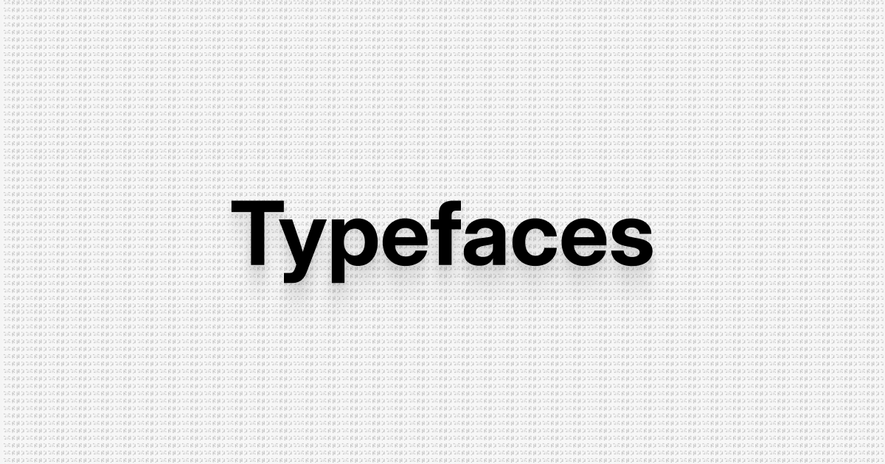

Features:

- Yet another lightweight typeface preview tool.
- Browse through Google Fonts or your local library (never uploaded; local fonts need a Chromium-based browser).
- Filter typefaces based on style, feel and appearance.
- Outline editor to modify vectors over typed-out text (Google fonts only).
- No analytics/cookies. API fetches from Wikipedia, Google Fonts and jsDelivr (editor only)

Inspired by [Kostić Type Foundry](https://kostictype.com/)'s website.
Article text from [Wikipedia](https://en.wikipedia.org/), [CC BY-SA 4.0](https://creativecommons.org/licenses/by-sa/4.0/).
[MIT](LICENSE), © sankelp. [LinkedIn](https://www.linkedin.com/in/sankalp-kanchan/).
